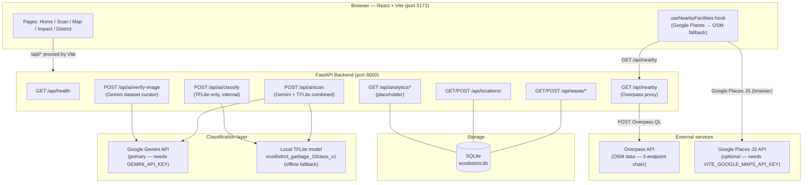

# EcoDistrict

### AI-powered waste identification, disposal guidance, and community recycling infrastructure — supporting UN SDG 12

> **Project status:** Phase 1 — active development. Core scanner, map, and API are functional. Analytics and personal impact dashboards display clearly-labelled sample data pending user authentication and a live data pipeline (Phase 2). This project is not yet in production deployment and does not claim verified real-world environmental impact.

---

## Table of Contents

- [Overview](#overview)
- [SDG 12 Alignment](#sdg-12-alignment)
- [Features](#features)
- [Screenshots](#screenshots)
- [Technology Stack](#technology-stack)
- [Architecture](#architecture)
- [Waste-Scanning Workflow](#waste-scanning-workflow)
- [Project Structure](#project-structure)
- [Prerequisites](#prerequisites)
- [Installation](#installation)
  - [1 — Clone the repository](#1--clone-the-repository)
  - [2 — Backend setup](#2--backend-setup)
  - [3 — Frontend setup](#3--frontend-setup)
- [Environment Configuration](#environment-configuration)
  - [Backend — `backend/.env`](#backend--backendenv)
  - [Frontend — `frontend/.env`](#frontend--frontendenv)
- [ML Model Setup](#ml-model-setup)
- [Running the Application](#running-the-application)
- [API Reference](#api-reference)
  - [Endpoint Summary](#endpoint-summary)
  - [POST /api/ai/scan — combined scanner](#post-apiaiscancombined-scanner)
  - [POST /api/waste/records — log a disposal event](#post-apiwasterecords--log-a-disposal-event)
  - [POST /api/locations/ — register a facility](#post-apilocations--register-a-facility)
  - [GET /api/nearby — proximity search](#get-apinearby--proximity-search)
- [Running Tests](#running-tests)
- [Troubleshooting](#troubleshooting)
- [Security and Privacy](#security-and-privacy)
- [Known Limitations](#known-limitations)
- [Roadmap](#roadmap)
- [Contributing](#contributing)
- [License](#license)
- [Acknowledgements](#acknowledgements)

---

## Overview

Improper waste disposal and low recycling rates are persistent challenges in urban districts. EcoDistrict addresses this by giving residents and administrators a practical digital tool that connects three parts of the waste-management problem:

1. **Identify** — photograph a waste item and get an AI-generated category and disposal instruction in seconds.
2. **Dispose correctly** — find the nearest verified recycling centre, e-waste drop-off, or composting point on a live map.
3. **Track impact** — log disposal events and view personal and district-level recycling trends (personal tracking previewed with sample data in Phase 1; live records require Phase 2 authentication).

The classifier combines Google Gemini (cloud, primary) with a locally-trained TensorFlow Lite model (offline fallback). The backend starts and the scanner continues to function even when the local model file is absent, provided Gemini is configured.

---

## SDG 12 Alignment

**Goal 12 — Responsible Consumption and Production** calls for sustainable management of natural resources, significant reduction of waste generation through prevention, reduction, recycling and reuse, and access to information for sustainable development.

EcoDistrict contributes to this goal by:

| SDG 12 Target | EcoDistrict capability |
|---|---|
| 12.5 — Substantially reduce waste generation through recycling and reuse | Correct disposal guidance for 10 waste categories; nearby recycling-facility discovery |
| 12.8 — Universal access to information for sustainable development | Educational disposal instructions embedded in scan results; no account required |
| 12.b — Develop and implement tools to monitor sustainable development impacts | District-level analytics dashboard (sample data now; live data in Phase 2) |

---

## Features

### ✅ Implemented and working

| Feature | Description |
|---|---|
| **Waste Image Scanner** | Upload or photograph any waste item → `POST /api/ai/scan` classifies it using Google Gemini (primary) with a local TFLite model as an automatic offline fallback. Returns category, disposal guidance, confidence, and a `primary_source` field indicating which classifier was used. |
| **Disposal Guidance** | All 10 classifier output classes (`battery`, `biological`, `cardboard`, `clothes`, `glass`, `metal`, `paper`, `plastic`, `shoes`, `trash`) have specific label, disposal type, and guidance text in the UI. |
| **Waste Map — Registered** | Leaflet/OpenStreetMap map centred on Ahmedabad showing verified disposal and recycling points stored in the SQLite database (`GET /api/locations/`). |
| **Waste Map — Find Nearby** | Browser geolocation search for real nearby waste-management facilities. Uses Google Places JS API when configured; falls back automatically to OpenStreetMap/Overpass via the backend proxy. No API key required for the OSM fallback path. |
| **Waste Map — Sample Locations** | Fixed set of illustrative reference locations (clearly labelled as preview data; not real Ahmedabad facilities) for UI demonstration. |
| **Waste Records API** | `GET/POST /api/waste/records` and `GET /api/waste/categories` — log and retrieve waste disposal events in SQLite. |
| **Locations API** | `GET/POST/GET-by-id /api/locations/` — manage physical disposal/recycling points. |
| **OSM Overpass Proxy** | `GET /api/nearby` — server-side Overpass QL proxy with coordinate validation, 2-minute in-process cache, three-endpoint fallback chain, and correct User-Agent header. |
| **Gemini Dataset Curator** | `POST /api/ai/verify-image` — evaluates whether an uploaded image is a suitable training candidate. Human-review assistant only; does not affect the TFLite classifier. Requires `GEMINI_API_KEY`. |
| **Live API Health Indicator** | Topbar pings `GET /api/health` on load; shows "API connected", "API offline", or "Checking…" based on real response. |
| **Graceful Missing-Model Handling** | If the `.tflite` file is absent at startup, the backend starts normally. Gemini handles scans; HTTP 503 is returned only if neither source can classify the image. |

### ⚠️ Sample Data / Phase 2 Placeholders

| Feature | Current state |
|---|---|
| **My Impact dashboard** | Renders with clearly-labelled illustrative sample data. Real per-user records require user authentication (Phase 2). |
| **District Dashboard** | Renders with clearly-labelled illustrative sample data. Live aggregation from `GET /api/analytics/*` requires Phase 2 data pipeline. |
| **Analytics endpoints** | `GET /api/analytics/summary` and `/monthly` return placeholder zeros with an explanatory `note` field. |
| **User authentication** | Database schema (`users` table) exists. No auth endpoints or JWT logic are implemented. `POST /api/waste/records` hardcodes `user_id=0`. |
| **Location management UI** | Locations are managed via the API; no frontend form exists yet. |

---

## Screenshots

> Screenshots will be added once a stable hosted deployment is available. To see the UI locally, follow the [Installation](#installation) steps and open `http://localhost:5173`.

---

## Technology Stack

### Frontend

| Library | Version | Purpose |
|---|---|---|
| React | 19 | UI component framework |
| Vite | 8 | Build tool and dev server with `/api` proxy |
| React Router | 7 | Client-side routing (`/`, `/scan`, `/map`, `/impact`, `/district`) |
| React Leaflet + Leaflet | 5 / 1.9 | Interactive OpenStreetMap map |
| Recharts | 3 | Bar, pie, and area charts |
| Tailwind CSS | 3 | Utility-first CSS |
| Lucide React | 1.49 | Icon set |

### Backend

| Library | Version | Purpose |
|---|---|---|
| Python | 3.12 | Runtime |
| FastAPI | 0.142 | REST API framework |
| Uvicorn | 0.54 | ASGI server |
| SQLAlchemy | 2.1 | ORM and database abstraction |
| SQLite | built-in | Local development database |
| Pydantic | 2.13 | Request/response validation |
| ai-edge-litert | 2.2 | TFLite inference runtime (LiteRT) |
| Pillow | 12 | Image pre-processing |
| NumPy | 2.5 | Tensor manipulation |
| httpx | 0.28 | Async HTTP client for the Overpass proxy |
| google-genai | ≥2.28 | Gemini API client |
| python-dotenv | 1.2 | `.env` file loading |

---

## Architecture



**Request flow for a waste scan:**

1. Browser uploads image to `POST /api/ai/scan`.
2. Backend runs TFLite inference (if model is loaded) and calls Gemini (if key is set) concurrently.
3. If Gemini returns a valid waste category, it becomes `primary_source="gemini"`.
4. If Gemini is absent or fails, `primary_source="model"` and the TFLite result is used.
5. If neither source is available, the endpoint returns HTTP 503.
6. Frontend displays category, disposal guidance, and an "Open Map" CTA to find nearby facilities.

---

## Waste-Scanning Workflow

```
Image upload
     │
     ▼
POST /api/ai/scan
     │
     ├── TFLite model present? ──Yes──► Run inference → model_category, model_confidence, top_predictions
     │                                                         │
     │                          ──No──► Skip TFLite           │
     │                                  (tflite_error =       │
     │                                   "model_unavailable") │
     │                                                         │
     ├── GEMINI_API_KEY set? ────Yes──► Call Gemini ──────────┤
     │                                  │                      │
     │                                  ├─ is_waste=true  ────►│ primary_source = "gemini"
     │                                  ├─ is_waste=false ────►│ primary_source = "model"
     │                                  └─ error/absent  ────►│ primary_source = "model"
     │                          ──No──► gemini_error =         │
     │                                   "not_configured"      │
     │                                                         │
     └── Resolve model_category ◄────────────────────────────-┘
              │
              ├── TFLite ran  ──────► Use TFLite category
              ├── TFLite absent, Gemini succeeded ──► Use Gemini category (model_confidence = 0)
              └── Both absent/failed ──────────────► HTTP 503
```

**`primary_source` tells the frontend which category to display to the user.** The `model_category` field in the response always contains the best available category string (never null) so the schema remains consistent.

### Gemini error codes

| `gemini_error` value | Meaning |
|---|---|
| `null` | Gemini succeeded or was not attempted (key absent) |
| `"not_configured"` | `GEMINI_API_KEY` environment variable is not set |
| `"rate_limited"` | Gemini quota exhausted (HTTP 429) |
| `"timeout"` | Gemini request exceeded the configured timeout |
| `"api_error"` | Gemini returned a non-quota API error |
| `"invalid_response"` | Gemini response failed Pydantic schema validation |
| `"image_too_large"` | Image exceeds the 10 MB Gemini inline-data limit |
| `"unexpected_error"` | Unclassified exception from the Gemini client |

---

## Project Structure

```
EcoDistrict/
├── .gitignore                         # Excludes .env, venv, node_modules, *.tflite, *.db
├── README.md
│
├── frontend/
│   ├── .env.example                   # Template — copy to .env; documents VITE_GOOGLE_MAPS_API_KEY
│   ├── vite.config.js                 # Dev proxy: /api → http://127.0.0.1:8000
│   ├── package.json
│   ├── tailwind.config.js
│   ├── index.html
│   └── src/
│       ├── App.jsx                    # Routes: / /scan /map /impact /district
│       ├── pages/
│       │   ├── Home.jsx               # Landing page with workflow overview
│       │   ├── ScanWaste.jsx          # Image upload → POST /api/ai/scan
│       │   ├── WasteMap.jsx           # 3-tab map: Registered / Sample Locations / Find Nearby
│       │   ├── MyImpact.jsx           # Personal charts (sample data — Phase 1)
│       │   └── DistrictDashboard.jsx  # District charts (sample data — Phase 1)
│       ├── components/
│       │   ├── Layout.jsx             # Sidebar nav + topbar with live API health check
│       │   ├── StatCard.jsx           # Reusable stat tile with "Sample value" note
│       │   └── DemoBanner.jsx         # Amber banner shown above any sample-data section
│       ├── services/
│       │   └── maps.js                # Google Places search + OSM element classification
│       ├── hooks/
│       │   └── useNearbyFacilities.js # Google Places → OSM Overpass fallback hook
│       └── data/
│           └── sampleLocations.js     # Illustrative sample locations (labelled, not real)
│
├── backend/
│   ├── .env.example                   # Template — copy to .env; documents GEMINI_API_KEY
│   ├── main.py                        # FastAPI app — CORS, route registration, startup hooks
│   ├── database.py                    # SQLAlchemy engine + session factory (SQLite default)
│   ├── models.py                      # ORM: User, WasteCategory, WasteRecord, Location
│   ├── requirements.txt
│   ├── routes/
│   │   ├── ai.py                      # POST /api/ai/scan, POST /api/ai/classify, GET /api/ai/categories
│   │   ├── verify.py                  # POST /api/ai/verify-image (Gemini dataset curator)
│   │   ├── nearby.py                  # GET /api/nearby (Overpass proxy)
│   │   ├── locations.py               # GET/POST /api/locations/
│   │   ├── waste.py                   # GET/POST /api/waste/records, GET /api/waste/categories
│   │   └── analytics.py               # GET /api/analytics/summary|monthly (placeholder)
│   ├── schemas/
│   │   ├── image_verify.py            # ImageVerifyResponse, GeminiVerification, CombinedScanResponse
│   │   ├── waste.py                   # WasteRecordCreate, WasteRecordOut, WasteCategoryOut
│   │   └── location.py                # LocationCreate, LocationOut
│   ├── services/
│   │   ├── gemini_verify.py           # Gemini API wrapper (timeout, retry, error mapping)
│   │   └── seed.py                    # Seeds 8 waste categories on first startup
│   ├── ml/
│   │   └── models/
│   │       ├── class_names.json       # 10 class labels (committed)
│   │       └── *.tflite               # Model weights — gitignored, obtain separately
│   └── tests/
│       ├── test_nearby.py             # 38 tests — Overpass proxy validation and behavior
│       └── test_scan.py               # 34 tests — combined scanner and missing-model handling
│
├── ml/                                # ML training/evaluation pipeline (scripts only)
├── data/
│   ├── sample_data/sample_records.json     # Reference sample records (not real user data)
│   └── waste_locations/sample_locations.json  # Reference sample locations (not verified)
└── docs/                              # Reserved for future documentation
```

---

## Prerequisites

| Requirement | Version | Notes |
|---|---|---|
| Python | 3.10 or later | Developed and tested on 3.12 |
| Node.js | 18 or later | For the frontend dev server and build |
| pip + venv | standard | Included with Python |
| Git | any recent | For cloning |

The TFLite classifier model file is **not included in this repository**. See [ML Model Setup](#ml-model-setup).

---

## Installation

### 1 — Clone the repository

```bash
git clone https://github.com/<your-username>/EcoDistrict.git
cd EcoDistrict
```

### 2 — Backend setup

```bash
cd backend

# Create a virtual environment
python3 -m venv venv

# Activate it
source venv/bin/activate        # Linux / macOS
# venv\Scripts\activate         # Windows (Command Prompt)
# venv\Scripts\Activate.ps1     # Windows (PowerShell)

# Install Python dependencies
pip install -r requirements.txt

# Copy the environment template
cp .env.example .env
# Edit .env and add your GEMINI_API_KEY (see Environment Configuration)
```

On first start the backend will:
1. Create `ecodistrict.db` (SQLite file) automatically.
2. Seed 8 waste categories into the database.
3. Attempt to load the TFLite model — if the file is absent, startup continues with a warning and Gemini handles scans instead.

### 3 — Frontend setup

Open a **separate terminal** and keep the backend running in the first:

```bash
cd frontend

# Install Node dependencies
npm install

# Copy the environment template
cp .env.example .env
# Edit .env if you want to add an optional Google Maps API key
```

---

## Environment Configuration

### Backend — `backend/.env`

Copy `backend/.env.example` to `backend/.env`. The file contains:

```dotenv
# Database URL — SQLite by default; change to PostgreSQL for production
DATABASE_URL=sqlite:///./ecodistrict.db

# Gemini API key — required for POST /api/ai/scan (primary classifier)
# and POST /api/ai/verify-image (dataset curation).
# Obtain a free key at https://aistudio.google.com/app/apikey
# NEVER commit this file or print this value anywhere.
GEMINI_API_KEY=
```

The backend starts without `GEMINI_API_KEY`. When the key is absent, `POST /api/ai/scan` uses only the local TFLite model. When both the key and model file are absent, the scan endpoint returns HTTP 503.

### Frontend — `frontend/.env`

Copy `frontend/.env.example` to `frontend/.env`:

```dotenv
# Optional — Google Maps / Places API key for the "Find Nearby" feature.
# When absent, the app falls back to free OpenStreetMap/Overpass data automatically.
# See frontend/.env.example for billing and key-restriction instructions.
VITE_GOOGLE_MAPS_API_KEY=
```

**Key restriction is mandatory** if you add a Google Maps key. Vite bakes all `VITE_*` variables into the JavaScript bundle at build time — the key is visible in the page source to anyone. Restrict it in [Google Cloud Console](https://console.cloud.google.com/google/maps-apis/):

- **Application restrictions** → HTTP referrers → add your domain and `http://localhost:5173/*`
- **API restrictions** → select *Maps JavaScript API* and *Places API* (legacy, not "Places API New")

An unrestricted key can be misused by anyone who finds it in the bundle.

---

## ML Model Setup

### Classifier: `ecodistrict_garbage_10class_v1`

| Property | Value |
|---|---|
| Format | TensorFlow Lite (`.tflite`) |
| Runtime | LiteRT (`ai-edge-litert 2.2`) |
| Input | 224 × 224 RGB, pixel values 0–255 (no normalisation) |
| Output | 10-class softmax probabilities |
| File size | ~8.5 MB |
| Classes | `battery` · `biological` · `cardboard` · `clothes` · `glass` · `metal` · `paper` · `plastic` · `shoes` · `trash` |

The model file is **excluded from this repository** (listed in `.gitignore`). A hosted download link will be published with the project release. Until then, contact the project maintainer to obtain the file and place it at:

```
backend/ml/models/ecodistrict_garbage_10class_v1.tflite
```

`backend/ml/models/class_names.json` (committed) contains the 10 class labels in index order and is the runtime source of truth.

**If the model file is missing**, the backend starts normally and logs a warning. Scans are handled by Gemini if `GEMINI_API_KEY` is set. HTTP 503 is returned only when neither source can classify the image.

---

## Running the Application

Start the backend and frontend in **two separate terminals**.

**Terminal 1 — backend:**

```bash
cd backend
source venv/bin/activate       # Linux / macOS
uvicorn main:app --reload --port 8000
```

Verify the backend is running:
- Health check: <http://127.0.0.1:8000/api/health>
- Swagger UI: <http://127.0.0.1:8000/api/docs>
- ReDoc: <http://127.0.0.1:8000/api/redoc>

**Terminal 2 — frontend:**

```bash
cd frontend
npm run dev
```

Open the app at <http://localhost:5173>

Vite proxies all `/api/*` requests to `http://127.0.0.1:8000` automatically — no manual CORS setup is needed during development.

---

## API Reference

Full interactive documentation is at **<http://127.0.0.1:8000/api/docs>** (Swagger UI) and **<http://127.0.0.1:8000/api/redoc>** (ReDoc).

### Endpoint Summary

| Method | Endpoint | Description | Status |
|---|---|---|---|
| GET | `/api/health` | Liveness probe | ✅ Live |
| GET | `/api/waste/categories` | List the 8 seeded waste categories | ✅ Live |
| GET | `/api/waste/records` | List waste disposal records (`skip`, `limit` params) | ✅ Live |
| POST | `/api/waste/records` | Log a new disposal event | ✅ Live |
| GET | `/api/waste/records/{id}` | Retrieve a single record | ✅ Live |
| GET | `/api/locations/` | List all registered disposal/recycling locations | ✅ Live |
| POST | `/api/locations/` | Register a new location (no auth yet) | ✅ Live |
| GET | `/api/locations/{id}` | Retrieve a single location | ✅ Live |
| GET | `/api/analytics/summary` | District summary — **placeholder zeros** | ⚠️ Placeholder |
| GET | `/api/analytics/monthly` | Monthly waste trend — **placeholder empty list** | ⚠️ Placeholder |
| POST | `/api/ai/scan` | **Primary scanner** — Gemini + TFLite combined (used by frontend) | ✅ Live |
| POST | `/api/ai/classify` | TFLite-only classifier (internal; not used by frontend) | ✅ Live |
| GET | `/api/ai/categories` | List classifier categories and model identifier | ✅ Live |
| POST | `/api/ai/verify-image` | Dataset-curation verdict via Gemini | ✅ Live (needs key) |
| GET | `/api/nearby` | Server-side Overpass QL proxy for nearby facilities | ✅ Live |

### POST /api/ai/scan — combined scanner

Multipart upload (`file` field). Runs TFLite and/or Gemini depending on availability.

**Example response — Gemini succeeded:**

```json
{
  "status": "success",
  "filename": "bottle.jpg",
  "model_category": "plastic",
  "model_confidence": 94.31,
  "top_predictions": [
    { "category": "plastic",   "confidence": 94.31 },
    { "category": "glass",     "confidence":  3.12 },
    { "category": "cardboard", "confidence":  1.44 }
  ],
  "model": "ecodistrict_garbage_10class_v1",
  "primary_source": "gemini",
  "gemini": {
    "is_waste": true,
    "category": "plastic",
    "confidence": "high",
    "agrees_with_model": true,
    "reason": "Clear image of a plastic bottle."
  },
  "gemini_error": null
}
```

**When Gemini is absent or fails:** `primary_source` is `"model"`, `gemini` is `null`, and `gemini_error` contains a code such as `"not_configured"`, `"rate_limited"`, `"timeout"`, or `"api_error"`.

**When the TFLite model is missing but Gemini succeeds:** `model_category` is populated from the Gemini result, `model_confidence` is `0.0`, and `top_predictions` is `[]`.

**HTTP 503** is returned only when neither Gemini nor TFLite can produce a result.

### POST /api/waste/records — log a disposal event

```json
{
  "waste_category": "plastic",
  "quantity": 0.8,
  "unit": "kg",
  "disposal_method": "Dry Recycling",
  "location_id": null,
  "notes": null
}
```

Response (`WasteRecordOut`):

```json
{
  "id": 1,
  "waste_category": "plastic",
  "quantity": 0.8,
  "unit": "kg",
  "disposal_method": "Dry Recycling",
  "created_at": "2025-06-18T10:30:00Z"
}
```

### POST /api/locations/ — register a facility

```json
{
  "name": "Ahmedabad Central Recycling Hub",
  "location_type": "Recycling Point",
  "latitude": 23.0225,
  "longitude": 72.5714,
  "address": "Near SG Highway, Ahmedabad",
  "description": "Accepts plastic, paper, and glass.",
  "accepted_waste": "Plastic,Paper,Glass"
}
```

### GET /api/nearby — proximity search

| Parameter | Type | Required | Range | Default | Description |
|---|---|---|---|---|---|
| `lat` | float | ✅ | −90 to 90 | — | Latitude of search centre |
| `lng` | float | ✅ | −180 to 180 | — | Longitude of search centre |
| `radius` | int | ❌ | 100 to 10 000 | 5000 | Search radius in metres |

Returns raw Overpass JSON. The frontend (`maps.js`) handles element classification into facility categories. Results are cached in memory for 2 minutes per (lat, lng, radius) key.

---

## Running Tests

```bash
cd backend
source venv/bin/activate
pytest tests/ -v
```

**Baseline: 72 tests pass** — 38 in `test_nearby.py` and 34 in `test_scan.py`.

| Test file | Count | Coverage |
|---|---|---|
| `test_nearby.py` | 38 | Overpass proxy: coordinate validation, query construction, 3-endpoint fallback chain, timeout handling, HTTP 429 rate-limiting, in-process cache (hit/miss), User-Agent header |
| `test_scan.py` | 34 | Combined scanner: Gemini primary/fallback paths, all `gemini_error` codes, TFLite-only path, size guard, missing-model handling (8 tests covering HTTP 503, Gemini-only 200, zero confidence, empty top_predictions) |

Frontend lint:

```bash
cd frontend
npm run lint
```

Expected: `0 warnings, 0 errors` (oxlint, 16 files, 104 rules).

Frontend production build:

```bash
cd frontend
npm run build
```

Expected: clean build. Vite emits a bundle-size advisory (Recharts and Leaflet bundled in a single chunk) — this is a performance note, not an error.

---

## Troubleshooting

### Backend does not start — TFLite model missing

```
WARNING: TFLite model could not be loaded — local classifier is unavailable.
```

This is expected when the `.tflite` file has not been placed at `backend/ml/models/ecodistrict_garbage_10class_v1.tflite`. The backend starts normally. If `GEMINI_API_KEY` is set, scans will use Gemini. See [ML Model Setup](#ml-model-setup).

### Scanner returns HTTP 503

Both Gemini and TFLite are unavailable. Check:
1. Is `backend/ml/models/ecodistrict_garbage_10class_v1.tflite` present?
2. Is `GEMINI_API_KEY` set in `backend/.env` and the key valid?

### Gemini returns `"not_configured"`

`GEMINI_API_KEY` is missing or empty in `backend/.env`. The scanner falls back to TFLite automatically. If you want Gemini classification, add the key and restart the backend.

### Frontend cannot connect to the backend — "API offline"

- Confirm the backend is running: `curl http://127.0.0.1:8000/api/health`
- Confirm Vite is running on port 5173 (not 3000 or another port)
- Check that `vite.config.js` proxies `/api` to `http://127.0.0.1:8000`

### Find Nearby returns no results

OSM data for waste and recycling facilities in many Indian cities is sparse. Zero results does not mean no facilities exist — it means they have not been mapped in OpenStreetMap yet. Try:
- Increasing the radius parameter (default 5 km, max 10 km)
- Adding a Google Maps API key for broader Places coverage
- Checking <https://www.openstreetmap.org/> directly for local data quality

### Overpass API returns HTTP 503 or times out

The backend tries three Overpass endpoints in order (`overpass.openstreetmap.fr`, `overpass-api.de`, `overpass.kumi.systems`). If all three are unavailable or overloaded, the endpoint returns HTTP 503 after exhausting the chain. Try again after a short wait.

---

## Security and Privacy

### Never commit secrets

- `backend/.env` contains `GEMINI_API_KEY`. It is excluded from Git by three independent rules in `.gitignore`. Never force-add it.
- `frontend/.env` contains `VITE_GOOGLE_MAPS_API_KEY`. Excluded by `frontend/.gitignore` and the root `.gitignore`.
- Both `.env.example` files contain only placeholder/empty values and are safe to commit.

```bash
# Verify nothing sensitive is staged before committing
git diff --check
git status
```

### Google Maps key exposure

Vite embeds all `VITE_*` variables in the compiled JavaScript bundle. The Google Maps key is readable by anyone who views the page source — this is normal for browser-side Maps usage, but the key **must** be restricted in [Google Cloud Console](https://console.cloud.google.com/google/maps-apis/) to prevent unauthorised use and unexpected billing.

### Data handling

- Uploaded images are processed in memory and not stored on disk.
- SQLite records (`waste_records`) contain no personally identifiable information in Phase 1 (`user_id` is hardcoded to `0`).
- No analytics data is transmitted to external services.

### Model files

`.tflite` model files are excluded from the repository because they are large binary artefacts unsuitable for Git history. They contain no secrets.

---

## Known Limitations

| Area | Detail |
|---|---|
| **Authentication** | No auth is implemented. All API endpoints are public. `POST /api/waste/records` uses a hardcoded `user_id=0`. Real per-user records require Phase 2. |
| **Analytics** | `GET /api/analytics/summary` and `/monthly` return placeholder zeros. The response includes a `"note"` field to make this explicit. |
| **No live per-user impact data** | "My Impact" and "District Dashboard" display hardcoded illustrative sample data. The DemoBanner component is displayed above every sample-data section. |
| **OSM coverage** | Recycling and waste facilities in many Indian cities are sparsely mapped in OpenStreetMap. Find Nearby may return zero results even where facilities exist. |
| **Single-worker cache** | `GET /api/nearby` uses an in-process Python dict cache. This works correctly for a single Uvicorn worker (development). A multi-worker production deployment would need a shared cache (e.g. Redis). |
| **SQLite in production** | SQLite is appropriate for development and low-traffic single-server use. Switch `DATABASE_URL` in `.env` to a PostgreSQL or MySQL connection string for production. |
| **Pydantic v2 deprecation warnings** | `backend/schemas/` uses the Pydantic v1 class-based `Config` style. Deprecation warnings appear at startup. The code functions correctly; migration to `model_config = ConfigDict(...)` is planned. |
| **Frontend bundle size** | Recharts and Leaflet are bundled in a single chunk (~900 kB unminified). This is a development convenience; route-based code-splitting is a planned optimisation. |

---

## Roadmap

The following items are planned and not yet implemented. No timeline is guaranteed.

**Phase 2 — Data and accounts**
- [ ] User authentication (JWT)
- [ ] Per-user waste records linked to authenticated accounts
- [ ] Live analytics aggregation from real database records
- [ ] Frontend location-management form

**Phase 3 — Scale and automation**
- [ ] Custom model retraining pipeline using Gemini-curated dataset
- [ ] Multi-district reporting and administrator roles
- [ ] Production deployment with PostgreSQL and Redis cache
- [ ] Route optimisation suggestions for waste collection

---

## Contributing

This project is currently in active development for an internship submission. Contributions, issue reports, and suggestions are welcome after the submission period. Please open an issue before submitting a pull request to discuss the proposed change.

---

## License

No license has been assigned to this repository yet. All rights reserved until a license is chosen. Contact the maintainer if you wish to use or build on this code.

---

## Acknowledgements

- [OpenStreetMap](https://www.openstreetmap.org/) contributors for map data and Overpass API access
- [Google Gemini](https://ai.google.dev/) for the AI classification API
- [React Leaflet](https://react-leaflet.js.org/) for the interactive map component
- [Recharts](https://recharts.org/) for the chart library
- [FastAPI](https://fastapi.tiangolo.com/) for the backend framework
- [TensorFlow Lite / LiteRT](https://ai.google.dev/edge/litert) for the on-device inference runtime

---

*EcoDistrict — Supporting UN SDG 12: Responsible Consumption and Production*
